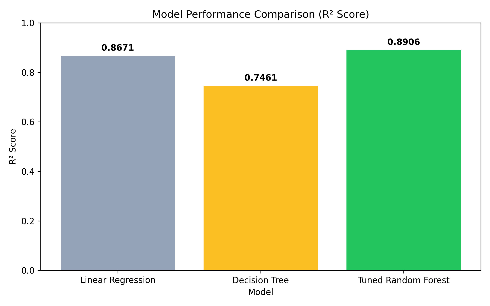
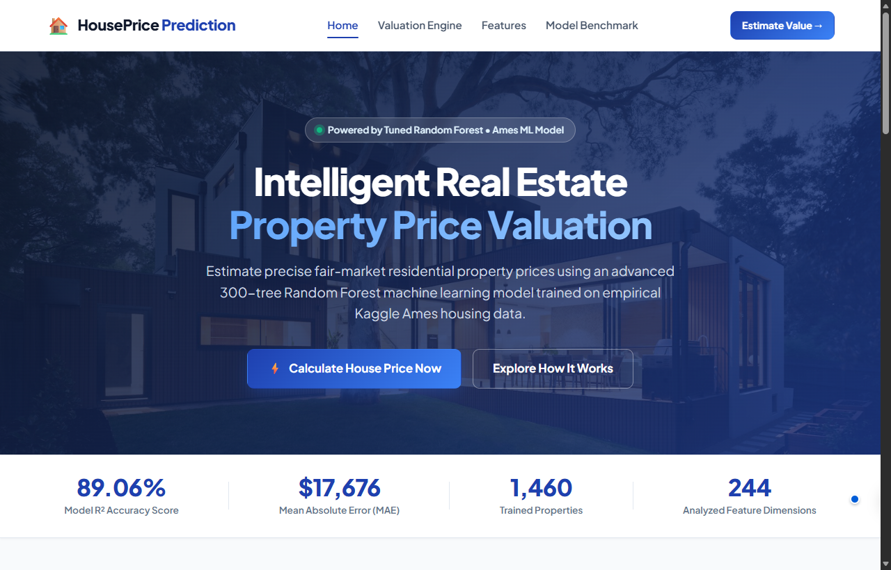

# 🏠 House Price Prediction

An end-to-end Machine Learning project that predicts house prices using a tuned Random Forest Regression model.

**Project owner:** [Amit Kumar](https://github.com/Amitkumar9956)
**GitHub repository:** [house-price-predictor-mini-project](https://github.com/Amitkumar9956/house-price-predictor-mini-project)

## 🚀 Live Demo

[Open Live House Price Prediction App](https://housepriceprediction-ff3ec9kvpcg2wyddtaokxu.streamlit.app/)

## 📌 Project Overview

This project predicts residential house prices using the Kaggle House Prices dataset.

The complete machine learning workflow includes:

- Data cleaning
- Missing value handling
- Exploratory data analysis
- One-hot encoding
- Feature engineering
- Train-test splitting
- Linear Regression
- Random Forest Regression
- Hyperparameter tuning
- Cross-validation
- Model evaluation
- Feature importance analysis
- Model saving and loading
- Interactive Web Application (Flask, HTML, CSS, JavaScript)
- Dedicated Result Page with price bands & breakdown
- 1-Click Launchers

## 🛠️ Technologies Used

- Python
- Pandas
- NumPy
- Scikit-learn
- Matplotlib
- Joblib
- Flask
- HTML5 / CSS3 / JavaScript

## 🤖 Machine Learning Models

### Linear Regression

| Metric | Score |
|---|---:|
| MAE | 20,383.82 |
| RMSE | 31,932.44 |
| R² Score | 0.8671 |

### Tuned Random Forest

| Metric | Score |
|---|---:|
| MAE | 17,778.25 |
| RMSE | 29,139.30 |
| R² Score | 0.8893 |

The Tuned Random Forest model performed better than Linear Regression on the test dataset.

### Model Performance Comparison



## 🖥️ Application Preview



## 📊 Important Features

The top features identified by the Random Forest model were:

1. OverallQual
2. GrLivArea
3. TotalBsmtSF
4. 2ndFlrSF
5. BsmtFinSF1
6. 1stFlrSF
7. LotArea
8. GarageArea
9. GarageCars
10. YearBuilt

`OverallQual` was the most important feature in the trained Random Forest model.

## 🔄 Machine Learning Workflow

```text
Dataset
   ↓
Data Cleaning
   ↓
Missing Value Handling
   ↓
One-Hot Encoding
   ↓
Train-Test Split
   ↓
Linear Regression
   ↓
Random Forest Regression
   ↓
Hyperparameter Tuning
   ↓
Cross Validation
   ↓
Model Evaluation
   ↓
Feature Importance
   ↓
Model Saving
   ↓
Streamlit Application
   ↓
Cloud Deployment
```

## 📂 Project Structure

```text
HousePricePrediction/
│
├── data/
│   ├── cleaned_train.csv       # Preprocessed training dataset
│   ├── data_description.txt    # Feature documentation
│   ├── processed_train.csv     # Encoded dataset for training
│   ├── sample_submission.csv   # Kaggle sample submission format
│   ├── test.csv                # Raw test set
│   └── train.csv               # Raw training set
│
├── models/
│   ├── baseline_input.pkl      # Median feature baseline for web app
│   ├── feature_columns.pkl     # Aligned one-hot encoded feature list
│   └── house_price_model.pkl   # Serialized Tuned Random Forest model
│
├── src/
│   ├── __init__.py             # Package initializer
│   ├── config.py               # Central project paths and hyperparameters
│   ├── evaluate.py             # Evaluation metrics (MAE, RMSE, R²)
│   ├── predict.py              # Inference engine and input validation
│   ├── preprocessing.py        # Data cleaning and imputation
│   ├── train.py                # Regression models (Linear, Tree, Forest)
│   └── visualization.py        # EDA plotting routines
│
├── static/
│   ├── app.js                  # Client-side dynamic calculations & UX
│   ├── style.css               # Modern responsive styling
│   └── images/                 # Background and UI artwork
│
├── templates/
│   ├── index.html              # Homepage with hero & project overview
│   ├── predict.html            # Dedicated property valuation input form
│   └── result.html             # Dedicated valuation result breakdown
│
├── tests/
│   ├── __init__.py
│   ├── test_api.py             # Integration tests for web server & API
│   └── test_pipeline.py        # Unit tests for ML pipeline & inference
│
├── Final_Deliverables/         # Academic Report & Presentation files
│   ├── House_Price_Prediction_Merged_Final_Report.docx
│   ├── House_Price_Prediction_Merged_Final_Report.pdf
│   ├── House_Price_Prediction_Presentation.pptx
│   └── House_Price_Prediction_Presentation.pdf
│
├── .dockerignore
├── .env.example
├── .gitignore
├── app.py                      # Main Web Application Launcher
├── Dockerfile                  # Production container definition
├── feature_importance.png      # Feature importance chart
├── flask_app.py                # Flask routes, API, and valuation engine
├── main.py                     # Full ML Training & Evaluation Pipeline
├── model_comparison.png        # Benchmark comparison chart
├── README.md                   # Project Documentation
├── requirements.txt            # Python Dependencies
├── run.bat                     # 1-Click Launcher for Web Application
├── run_tests.bat               # 1-Click Automated Test Runner
└── train_model.bat             # 1-Click Retraining Script
```

## ⚙️ Installation

### 1. Move into the project directory

```bash
cd HousePricePrediction-main
```

### 2. Install the required dependencies

```bash
pip install -r requirements.txt
```

## ▶️ Running the Application

### 1. Launch the Interactive Web Application
Double-click `run.bat` or execute in terminal:
```bash
python app.py
```
This automatically launches your default browser at: `http://127.0.0.1:5000`

### 2. Run the Full ML Training Pipeline
Double-click `train_model.bat` or execute in terminal:
```bash
python main.py
```
This cleans raw data, trains Linear Regression, Decision Tree, and Tuned Random Forest models, performs 5-fold cross-validation, saves evaluation charts, and serializes the best model.

### 3. Run Automated Unit & Integration Tests
Double-click `run_tests.bat` or execute in terminal:
```bash
python -m unittest discover tests
```

## 📈 Results

The tuned Random Forest model achieved the following results on the test dataset:

| Metric | Score |
|---|---:|
| MAE | 17,778.25 |
| RMSE | 29,139.30 |
| R² Score | 0.8893 |

The model provides better performance than the Linear Regression baseline.

## 🌐 Deployment

The application has been deployed using Streamlit Community Cloud.

### Live Application

[Open Live House Price Prediction App](https://housepriceprediction-ff3ec9kvpcg2wyddtaokxu.streamlit.app/)

The deployed application allows users to enter house characteristics and receive an estimated house price.

## 💡 Key Findings

- Random Forest performed better than Linear Regression.
- `OverallQual` was the most influential feature.
- `GrLivArea` was the second most important feature.
- Basement area and living-area features significantly contributed to prediction.
- Garage-related features also influenced house prices.
- The tuned Random Forest achieved an R² score of approximately `0.8893`.

## 🎯 Future Improvements

Possible future improvements include:

- Trying Gradient Boosting models
- Testing XGBoost or LightGBM
- Advanced feature engineering
- Hyperparameter optimization using GridSearchCV or RandomizedSearchCV
- Improving the Streamlit user interface
- Adding prediction confidence or uncertainty estimates
- Adding more visualizations
- Improving model performance

## 👨‍💻 Author

**[Amit Kumar](https://github.com/Amitkumar9956)**

B.Tech CSE & AIML

---

⭐ If you find this project useful, consider giving the repository a star!\n
