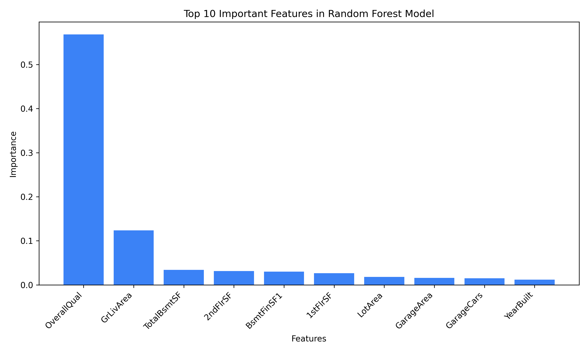

# House Price Prediction

An end-to-end machine learning project that estimates house prices from property features using a trained Random Forest regression model. It includes a Flask web app, a JSON prediction API, model training and evaluation scripts, and the final project report and presentation.

**GitHub repository:** [Amitkumar9956/house-price-predictor-mini-project](https://github.com/Amitkumar9956/house-price-predictor-mini-project)

## Live demo

[Open the hosted house price prediction app](https://housepriceprediction-ff3ec9kvpcg2wyddtaokxu.streamlit.app/)

Run the current Flask application locally by following the instructions below.

## Features

- Interactive property valuation form and dedicated results page.
- Random Forest model inference with input validation.
- JSON prediction endpoint at `/api/predict` and health endpoint at `/health`.
- Training, preprocessing, evaluation, and feature-importance visualization pipeline.
- Windows launch scripts for the app, model training, and tests.
- Project report, presentation, and application screenshots.

## Run locally

Requirements: Python 3.10 or newer.

```bash
git clone https://github.com/Amitkumar9956/house-price-predictor-mini-project.git
cd house-price-predictor-mini-project
pip install -r requirements.txt
python app.py
```

The app opens at [http://127.0.0.1:5000](http://127.0.0.1:5000). On Windows, you can also double-click [`run.bat`](run.bat).

## Train and evaluate

Run `python main.py` or double-click [`train_model.bat`](train_model.bat). The pipeline preprocesses the training data, trains and evaluates the regression models, and saves model artifacts and charts.

To run the automated tests:

```bash
python -m unittest discover tests
```

On Windows, [`run_tests.bat`](run_tests.bat) runs the same command.

## API

`POST /api/predict` accepts a JSON object with house features and returns a predicted price. `GET /health` reports whether the service is available. See [`flask_app.py`](flask_app.py) for the route implementation and input handling.

## Project files

- [`app.py`](app.py) — local web app entry point.
- [`flask_app.py`](flask_app.py) — Flask pages and API routes.
- [`src/`](src/) — preprocessing, training, evaluation, configuration, and prediction code.
- [`data/`](data/) — source and processed datasets.
- [`models/`](models/) — saved model and prediction input artifacts.
- [`templates/`](templates/) and [`static/`](static/) — web pages, styles, scripts, and images.
- [`main.py`](main.py) — full training and evaluation pipeline.
- [`Final_Deliverables/README.md`](Final_Deliverables/README.md) — report and presentation overview.
- [Project report (PDF)](Final_Deliverables/House_Price_Prediction_Merged_Final_Report.pdf)
- [Project presentation (PDF)](Final_Deliverables/House_Price_Prediction_Presentation.pdf)

## Model results

The project README's recorded evaluation results are:

| Model | MAE | RMSE | R-squared |
| --- | ---: | ---: | ---: |
| Linear Regression | 20,383.82 | 31,932.44 | 0.8671 |
| Tuned Random Forest | 17,778.25 | 29,139.30 | 0.8893 |




## Author

**Amit Kumar** — B.Tech CSE & AIML
